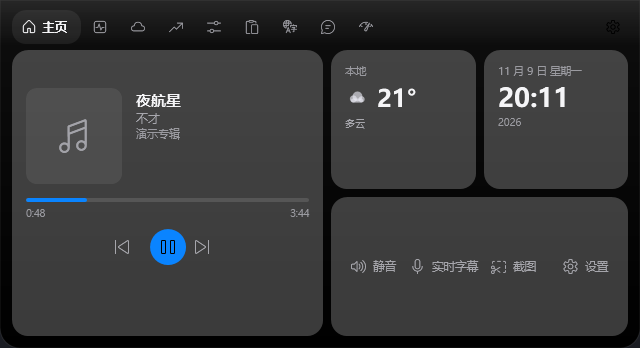
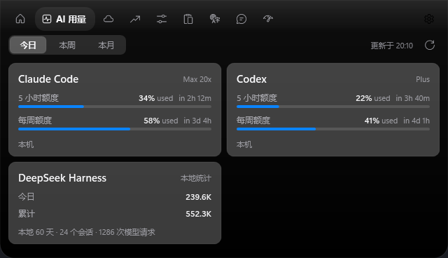
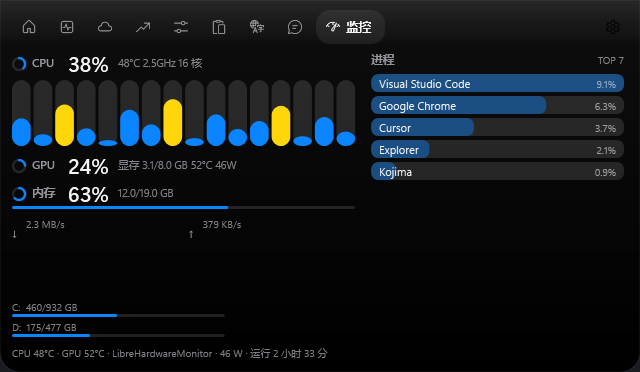
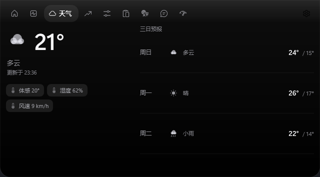
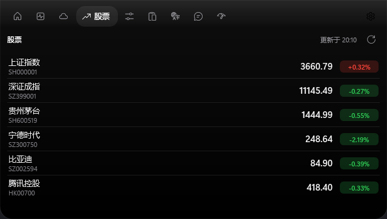
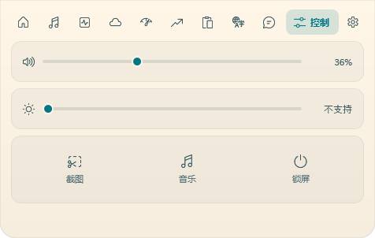

# Kojima

Windows 桌面灵动岛（Dynamic Island）。下载：[最新版本](https://github.com/mengtiankf/kojima/releases)

界面与调度在主进程，监控、用量这类重活放在**按需启动的子进程**里（空闲自动退出）；岛体材质、肩部曲线与主题文件沿用 [BrimDeck](https://github.com/MoFeng2223/BrimDeck) 的设计语言。








> 以上图片由 `KOJIMA_DEMO=1` 的演示数据渲染，不含任何真实账号或行情缓存。

## 功能

| 模块 | 说明 |
| --- | --- |
| 灵动岛 | 顶部居中 / 上靠左 / 上靠右三档位置；刘海 / 胶囊 / 指示条三种形态；悬停展开、离开自动收起，动画时长可调，**不支持拖动**，位置只在设置里改 |
| 收起时显示 | 时钟和天气 / 仅时钟 / 仅天气 / 媒体信息 / 不显示，五档任选 |
| 首页 | 时钟、日期、天气、媒体卡（封面 / 实时频谱 / 上一首 / 播放暂停 / 下一首）与常驻快捷操作（静音 / 实时字幕 / 截图 / 设置） |
| AI 用量 | 13 个来源：Claude、Codex、Cursor、Antigravity、DeepSeek Harness、Kimi、OpenCode、ZCode、DeepSeek、OpenRouter、GLM、NewAPI、Sub2API；今日 / 本周 / 本月 Token 与额度（额度依赖服务端公开接口，缺失时显示本地 Token 并给出说明） |
| 系统监控 | CPU（总/每核）、GPU（利用率/显存/温度/功耗）、内存、网络、磁盘、温度、进程 TOP 7；温度与功耗可接 LibreHardwareMonitor / OpenHardwareMonitor |
| 天气 | 当前天气 + 三日预报；可在设置里填写城市（如 上海、Tokyo），留空按 IP 定位；图标为自绘矢量，不依赖字体码位 |
| 股票 | 自选股（默认上证 / 深证 / 茅台 / 宁德 / 比亚迪 / 腾讯），行情代码与刷新间隔可在设置里改，红涨绿跌 |
| 控制 | 音量、亮度、截图、实时字幕（转发 Win+Ctrl+L 唤起 Windows 实时字幕，旧系统回退到辅助功能设置）、音乐（可在设置里指定任意 exe）、锁屏 |
| 剪贴板 | 400 ms 序列号轮询，最近 40 条文本，点击写回剪贴板 |
| 翻译 | 中→日 / 中→英；引擎可选 Google 翻译 / MyMemory / 百度翻译 / 微软翻译 / DeepSeek / 自定义 OpenAI 兼容大模型（自动模式优先 DeepSeek，其次 Google） |
| 消息 | 应用内通知中心：CPU 占用过高、天气变化、持仓提醒等 |
| 主题 | 内置 11 套 BrimDeck 主题，支持 `%LOCALAPPDATA%\Kojima\themes` 放入自定义主题 |
| 设置 | 独立设置窗口：通用 / 外观 / 功能 / 用量 / 关于；每个功能模块的详细配置在二级菜单里；主题即点即生效，滚动条为沉浸式细条；展开态右键也可打开 |
| 导航 | 悬停标签即切换页面，不需要点击；标签顺序可在「设置 → 功能」里用 ↑ ↓ 调整 |

## 架构

```
Kojima.Shell (WPF, 主进程)             Kojima.Agents (子进程, 按需拉起)
  ├─ 灵动岛窗口 / 页面 / 托盘 / 热键       ├─ monitor   采样 CPU/GPU/内存/网络/进程
  ├─ ConfigStore / ThemeCatalog          ├─ usage     本地会话日志 + 账户额度
  └─ AgentSupervisor ─── NamedPipe ───▶  └─ …         其它功能在 Shell 内
```

- 子进程只在功能被真正使用时由 `AgentSupervisor` 拉起，空闲 `IdleExitSeconds`（默认 90 秒）后自行退出；关闭功能开关会立即回收。
- IPC 是逐行 JSON 的命名管道：`kojima-{feature}-{shellPid}`，主进程发 `IpcEnvelope{Id,Method,Params}`，子进程回 `{Id,Result}` 或推 `{Event,Data}`。
- 共享模型、配置、主题与几何算法都在 `Kojima.Core`，两个进程引用同一份代码。

## 安装

从 [Releases](https://github.com/mengtiankf/kojima/releases) 下载，或本地构建后从 `dist/` 取用：

- `dist/KojimaSetup-1.2.7.exe`：Inno Setup 安装包（默认装到 `%LOCALAPPDATA%\Programs\Kojima`，可选开机启动、桌面快捷方式）
- `publish/`：绿色版，直接运行 `Kojima.Shell.exe`

配置与日志在 `%LOCALAPPDATA%\Kojima`：

```
config.json      # 设置（位置、形态、主题、收起显示、功能开关、用量来源、监控数据源；不含任何密钥）
secrets.dat      # 密钥（DPAPI 当前用户加密，仅本机可解；首次启动会把旧版 config.json 里的明文密钥迁走并抹除）
logs/            # shell.log / agent-*.log
themes/          # 自定义主题（JSON，可带 // 注释）
```

密钥只写入 `secrets.dat`，`config.json` 与日志里都不会出现明文；用量读取只使用本地日志或各服务的官方接口，不写回、不续期任何登录状态。

## 快捷键

| 快捷键 | 作用 |
| --- | --- |
| `Ctrl+Alt+K` | 展开 / 收起面板 |
| `Ctrl+Alt+S` | 打开设置 |
| `Ctrl+Alt+M` | 直接打开监控页（被占用时回退到 `Ctrl+Alt+O`） |

## 构建

需要 .NET 10 SDK：

```powershell
dotnet build Kojima.slnx
dotnet test tests/Kojima.Tests/Kojima.Tests.csproj
dotnet run --project src/Kojima.Shell
```

打安装包（publish → Inno Setup，仅 exe）：

```powershell
powershell -ExecutionPolicy Bypass -File build.ps1
```

需要 `ISCC.exe`（Inno Setup 6）在 PATH 中；脚本只产出 exe 安装包，不再构建 MSI。

## 开发钩子

| 环境变量 | 作用 |
| --- | --- |
| `KOJIMA_PREVIEW=<page>` | 启动后直接展开并切到指定页（home / usage / monitor / weather / stocks / ctl / clip / translate / msg） |
| `KOJIMA_SHOT=<path>` | 启动后把窗口渲染成 PNG（配合 `KOJIMA_SHOT_DELAY=<ms>`） |
| `KOJIMA_DEMO=1` | 用内置演示数据填充页面与通知，用于生成文档截图 |

## 致谢

- 岛体几何、主题 JSON 格式与设计语言来自 [BrimDeck](https://github.com/MoFeng2223/BrimDeck)（Apache-2.0），主题版权归各作者，详见 [THIRD_PARTY.md](THIRD_PARTY.md)。
- 图标使用 Segoe Fluent Icons；天气图标为本项目自绘。

## 许可

[MIT](LICENSE)
