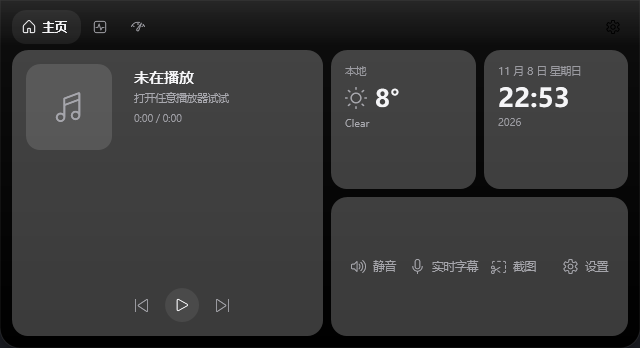
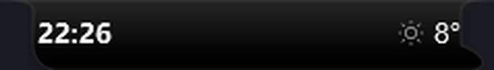
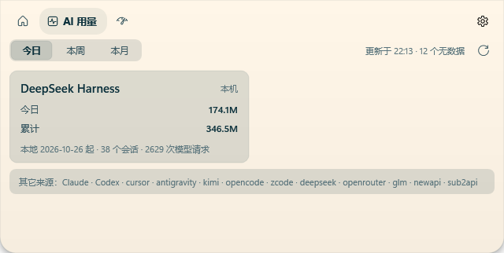
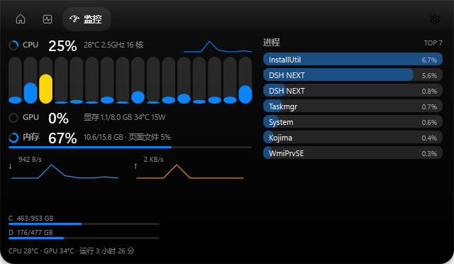

# Kojima

Windows 桌面灵动岛（Dynamic Island）。下载：[最新版本](https://github.com/mengtiankf/kojima/releases)主进程只负责界面与调度，功能全部放在**按需启动的子进程**里；岛体材质、肩部曲线与主题文件沿用 [BrimDeck](https://github.com/MoFeng2223/BrimDeck) 的设计语言。






## 功能

| 模块 | 说明 |
| --- | --- |
| 灵动岛 | 顶部居中 / 上靠左 / 上靠右三档位置；Notch（上凸缺口）、Capsule（胶囊）、Indicator（指示条）三种形态；悬停展开、离开自动收起，**不支持拖动**，位置只在设置里改 |
| 首页 | 时钟、日期、天气、媒体卡与常驻快捷操作（静音 / 实时字幕 / 截图 / 设置） |
| AI 用量 | 13 个来源：Claude、Codex、Cursor、Antigravity、DeepSeek Harness、Kimi、OpenCode、ZCode、DeepSeek、OpenRouter、GLM、NewAPI、Sub2API；今日 / 本周 / 本月 Token 与额度 |
| 系统监控 | CPU（总/每核）、GPU（利用率/显存/温度/功耗）、内存、网络、磁盘、温度、进程 TOP 7 |
| 主题 | 内置 11 套 BrimDeck 主题，支持 `%LOCALAPPDATA%\Kojima\themes` 放入自定义主题 |
| 设置 | 独立设置窗口：通用 / 外观 / 功能 / 用量 / 关于 |

## 架构

```
Kojima.Shell (WPF, 主进程)          Kojima.Agents (子进程, 每个功能一个)
  ├─ 灵动岛窗口 / 页面 / 托盘 / 热键      ├─ monitor   采样 CPU/GPU/内存/网络/进程
  ├─ ConfigStore / ThemeCatalog          ├─ usage     读取本地会话日志
  └─ AgentSupervisor ─── NamedPipe ───▶  └─ …         其它功能占位
```

- 子进程只在功能被真正使用时由 `AgentSupervisor` 拉起，空闲 `IdleExitSeconds`（默认 90 秒）后自行退出；关闭功能开关会立即回收。
- IPC 是逐行 JSON 的命名管道：`kojima-{feature}-{shellPid}`，主进程发 `IpcEnvelope{Id,Method,Params}`，子进程回 `{Id,Result}` 或推 `{Event,Data}`。
- 共享模型、配置、主题与几何算法都在 `Kojima.Core`，两个进程引用同一份代码。

## 安装

从 [Releases](https://github.com/mengtiankf/kojima/releases) 下载，或本地构建后从 `dist/` 取用：

- `dist/KojimaSetup-1.0.0.exe`：Inno Setup 安装包（默认装到 `%LOCALAPPDATA%\Programs\Kojima`，可选开机启动、桌面快捷方式）
- `dist/Kojima-1.0.0-x64.msi`：WiX 安装包（per-user）
- `publish/`：绿色版，直接运行 `Kojima.exe`

配置与日志在 `%LOCALAPPDATA%\Kojima`：

```
config.json      # 设置（位置、形态、主题、功能开关、用量来源与密钥）
logs/            # shell.log / agent-*.log
themes/          # 自定义主题（JSON，可带 // 注释）
```

## 快捷键

| 快捷键 | 作用 |
| --- | --- |
| `Ctrl+Alt+K` | 展开 / 收起面板 |
| `Ctrl+Alt+S` | 打开设置 |
| `Ctrl+Alt+M` | 直接打开监控页 |

## 构建

需要 .NET 10 SDK。

```powershell
dotnet build Kojima.slnx -c Debug
dotnet run --project src/Kojima.Shell
```

打包（publish → 安装包）：

```powershell
powershell -File build.ps1
```

`build.ps1` 会 `dotnet publish` 到 `publish/`，再调用 Inno Setup 的 `ISCC.exe` 与 WiX 的 `wix.exe` 生成 `dist/` 下的 exe 与 msi。

## 开发用环境变量

| 变量 | 作用 |
| --- | --- |
| `KOJIMA_PREVIEW=<home\|usage\|monitor>` | 启动后直接展开到指定页面（钉住，方便截图） |
| `KOJIMA_SHOT=<png 路径>` | 到点把灵动岛窗口渲染成 PNG |
| `KOJIMA_SHOT_DELAY=<毫秒>` | 截图延迟，默认 4000 |

## 致谢

- 视觉与主题文件来自 [BrimDeck](https://github.com/MoFeng2223/BrimDeck)（Apache-2.0），主题 JSON 原样保留，版权归原作者。
- 图标字体使用 Windows 自带的 Segoe Fluent Icons。

## 许可

MIT，见 [LICENSE](LICENSE)。第三方资源见 [THIRD_PARTY.md](THIRD_PARTY.md)。
